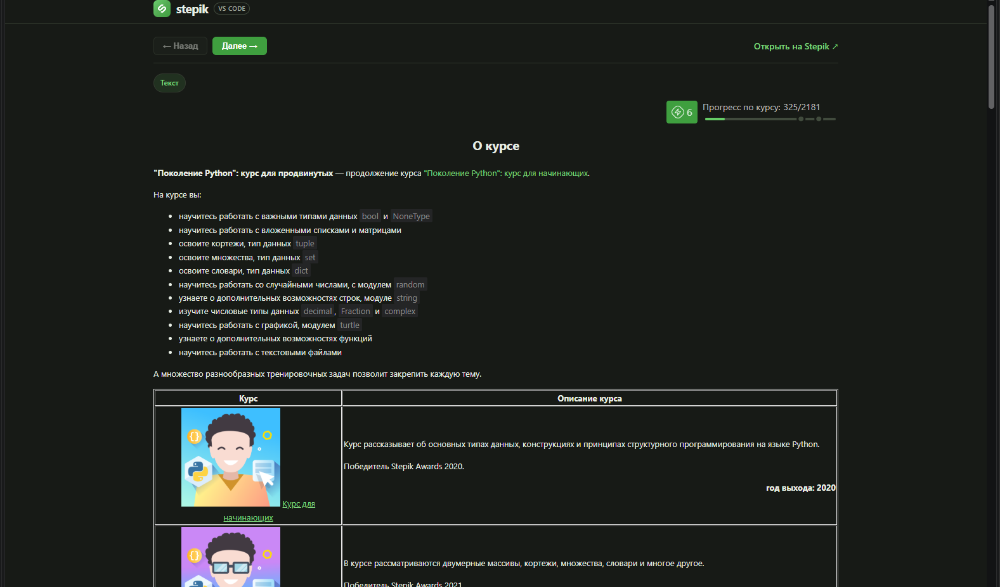
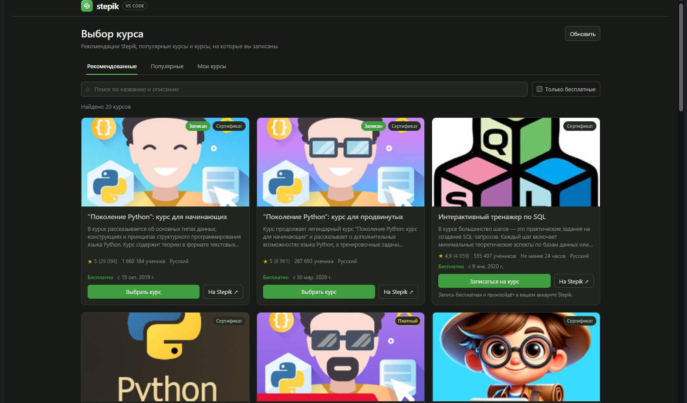
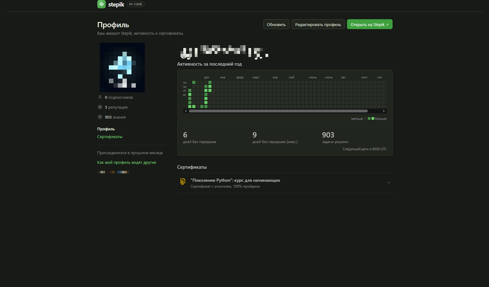
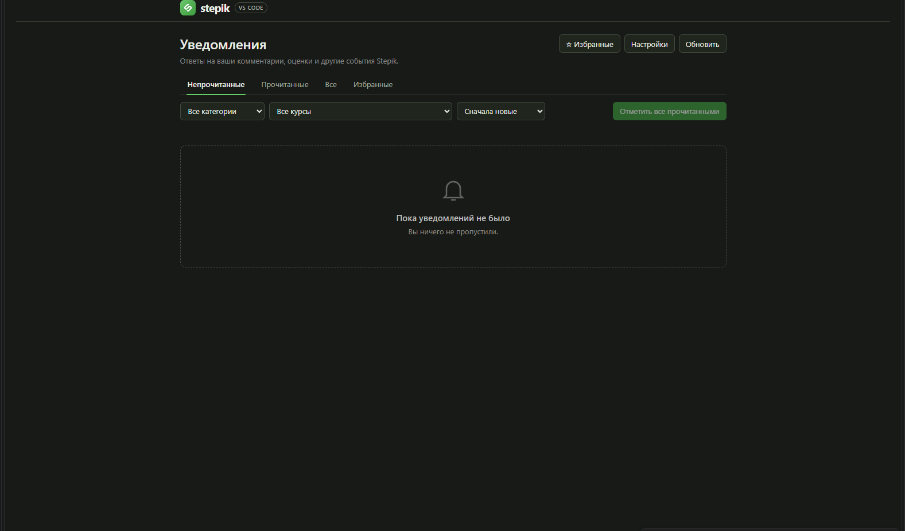
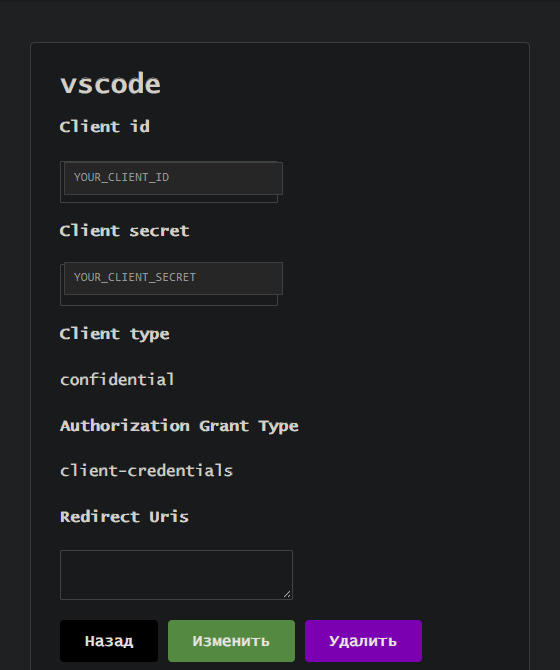
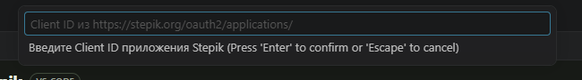
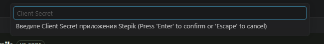

<div align="center">


# Stepik for VS Code

**Solve Stepik problems without leaving your editor.**

Courses, theory, quizzes, code, exams, video, and discussions — all in one VS Code window.

[](CHANGELOG.md)
[](https://code.visualstudio.com/)
[](LICENSE.txt)
[](#interface-language)

[Русская версия](README.md) · [Changelog](CHANGELOG.md) · [Issues](https://github.com/danilproskurin291-cmd/stepik-vscode/issues)

</div>



## What's new in 0.4.11

- **Solved tasks reopen with the submitted answer.** Choice, short answer,
  number, formula, free-answer, sorting, matching, table, fill-blanks, SQL,
  HTML, dataset, chemistry, and puzzle steps restore their answer from Stepik.
- **A solved task cannot be edited by accident.** The form stays locked until
  you press **Edit** or **Start over**; an answer that is still being reviewed
  shows a pending state.
- **Clear status.** The panel shows a banner with the score and feedback, and a
  hint to fix the answer after a wrong attempt.
- **Fill-blanks fixed.** Inputs and selects are prefilled from the saved answer,
  every blank is required, and select values are checked against the Stepik
  dataset.
- **Everything from 0.4.10 is preserved:** the fixed activity calendar and
  step-type icons.

## Features

| | |
| --- | --- |
| 📚 **Course tree** | Sections, lessons, and steps with progress markers in the sidebar. |
| 🧩 **Every task type** | Quizzes, short answers, numbers, formulas, sorting, tables, blanks, SQL, HTML/CSS, chemistry, puzzles, code, and random tasks. |
| 💻 **Solutions as files** | A dedicated `~/stepik/<account>` folder with a course → lesson → step layout. |
| ✅ **Checks and retries** | Submit from the editor, read detailed feedback, and retry in one click. |
| ⏱ **Exams** | Timer, submission lock after the deadline, and active-session recovery. |
| 🎬 **Video** | Built-in player with quality, subtitles, and automatic view tracking. |
| 💬 **Comments** | Rich editor, Markdown, formulas, images, replies, votes, and sorting. |
| 🏆 **Solutions forum** | Solutions for every checkable task type, including teacher answers. |
| 📈 **Progress** | Streak, points, completion bar, and distance to the certificate. |
| 🔔 **Notifications** | Background watcher, toasts, and an unread history. |
| 👤 **Profile** | Learning stats, achievements, certificates, and a public preview. |
| 🌗 **Themes** | Light, dark, and high contrast — always readable. |
| 🌐 **Language** | `auto`, `ru`, or `en` for every panel and notification. |

## Screenshots

### Course catalog

Search, recommendations, popular courses, a free-only filter, and direct
enrollment in free courses without opening the website.



### Task panel

Statement, answer form, progress, comments, and the solutions forum in one
panel. For code tasks, the solution file opens next to it in the editor.


### Profile

Learning stats, streak, achievements, and certificates. The avatar, name, and
ID are redacted in the screenshot.



### Notifications

Replies to comments, solution checks, and other Stepik events.



## Installation

### Ready-made VSIX

1. Download `stepik-vscode-fork-0.4.11.vsix` from
   [Releases](https://github.com/danilproskurin291-cmd/stepik-vscode/releases).
2. Install it:

   ```bash
   code --install-extension stepik-vscode-fork-0.4.11.vsix
   ```

   Or open **Extensions → … → Install from VSIX…** and pick the file.
3. Reload the window: **Developer: Reload Window**.

The Stepik icon appears in the Activity Bar after installation.

### From source

Requires Node.js 18+.

```bash
npm ci
npm run build
npx @vscode/vsce package
code --install-extension stepik-vscode-fork-0.4.11.vsix
```

## Quick start

1. Click the **Stepik** icon in the Activity Bar.
2. Run **Stepik: Login** and enter your OAuth application credentials.
3. Choose a course with **Stepik: Select Course** or open
   **Stepik: Browse Courses**.
4. Open any step in the tree.
5. Solve the task in the panel or in the editor file, then submit.

On the first login the extension creates the solutions folder
`~/stepik/<account-name>`. You do not need to open it as a workspace.

## OAuth login

The extension uses OAuth 2.0 with the `client-credentials` grant type. You do
not enter your Stepik password — only the Client ID and Client Secret of your
OAuth application.

### 1. Create an application

1. Sign in to Stepik and open
   <https://stepik.org/oauth2/applications/>.
2. Click **New application**.
3. Fill in:
   - **Name** — anything, for example `Stepik VS Code`;
   - **Client type** — `confidential`;
   - **Authorization grant type** — `client-credentials`;
   - **Redirect uris** — may stay empty.
4. Save the application and copy the **Client ID** and **Client Secret**.



> In the screenshot the Client ID and Client Secret are replaced with the
> placeholders `YOUR_CLIENT_ID` and `YOUR_CLIENT_SECRET`. Your real keys are
> never published.

### 2. Enter the Client ID

Run **Stepik: Login**. VS Code asks for the Client ID:



### 3. Enter the Client Secret

The secret is entered hidden and stored in VS Code `SecretStorage`, not in
regular settings.



After login the access token refreshes automatically. **Stepik: Logout** first
creates a ZIP archive of your solutions, then removes the saved credentials.

## Interface language

Switch the language with **Stepik: Change Interface Language** or through the
setting:

```json
"stepik.language": "auto"
```

| Value | Behaviour |
| --- | --- |
| `auto` | Follow the VS Code display language; fall back to English. |
| `ru` | Russian interface. |
| `en` | English interface. |

The setting applies immediately: panels, tree, notifications, profile, and
catalog refresh without a restart.

## Interface

### Sidebar

The selected course tree shows sections, lessons, and steps. Colors and icons
communicate the state:

- 🟢 green — the step or lesson is complete;
- 🟡 yellow — the step is started but not finished;
- 🔒 lock — the material is locked;
- ⏱ an exam section offers **Start exam**.

The panel title bar has course selection, refresh, notifications, profile,
login/logout, and language switching.

### Task panel

Opening a step shows the **Stepik Task** panel:

- **← Back** and **Next →** buttons;
- an **Open on Stepik ↗** link;
- task type and statement;
- an answer form or language picker for code tasks;
- the progress block;
- comments and the solutions tab.

### Progress

The task panel shows your streak, earned and maximum points, a completion bar,
and a hint about how much is left to the certificate.

## Solving tasks

### Code tasks

1. Open a **code** step.
2. Pick a programming language.
3. Click **Open in Editor**.
4. Write the solution in the created file and save it.
5. Submit with the cloud button in the editor title or with
   **Stepik: Submit Solution**.

File path:
`~/stepik/<account-name>/<course>/<lesson>/step-<number>.<extension>`.

The template is created once and never overwrites an existing file. If you
move the file manually, reopen the step so the extension can restore the
file-to-task mapping.

### Other task types

Every checkable Stepik type is supported. Usually you fill in the form and
click **Submit**. If the answer is wrong, details appear in a notification and
in **Output → Stepik**.

| Step type | What the extension does |
| --- | --- |
| `text` | Shows the theory and marks the step as viewed. |
| `video` | Built-in player with quality, subtitles, and view tracking. |
| `choice` | One or several answer options. |
| `string`, `number` | Short text or numeric answer. |
| `math` | Formula with equivalence checking. |
| `free-answer` | Free-form answer (no file attachments). |
| `sorting`, `matching`, `table` | Sorting, pairs, and table tasks. |
| `fill-blanks` | Blanks: typed input or a selection from a list. |
| `sql`, `html` | SQL and HTML/CSS tasks with checks. |
| `dataset` | Data file and solution submission. |
| `chemical`, `puzzle` | Chemical formula and puzzle. |
| `code` | Solution file in the editor, language selection, and submission. |
| `random-tasks` | Hint and a link to the step: the random task is generated on Stepik's side. |

`text` and `video` steps open as reading material and are marked as viewed
automatically. For `random-tasks` the extension does not create an attempt:
instead of an answer form it shows a hint and an **Open the step on Stepik ↗**
link.

## Exams

1. Click **Start exam** on an exam section.
2. Confirm the start.
3. The extension creates a session through the Stepik API and opens the first
   step.
4. A **Time left …** timer appears in the panel.

Submissions are locked when time runs out. If the exam was already started on
the website or in another window, the extension resumes the existing session.

## Video

Video steps open in the built-in player with quality selection, subtitles, a
preview, fullscreen mode, and a link to the original. Watching is recorded on
Stepik automatically.

VS Code's embedded Chromium cannot decode AAC audio from MP4, so on first open
the extension downloads the video, extracts the audio track, converts it to
MP3, and caches it. If audio does not start, click **Enable sound** or open the
video in a browser.

## Comments and solutions

- the first page of comments loads when a step opens;
- further pages load on scroll;
- pinned comments are shown separately;
- replies expand with **Show replies (N)**;
- votes, sorting, and teacher badges are supported;
- your own comments can be edited, deleted, and copied as a link.

The rich editor supports **B**, **I**, **U**, strikethrough, inline code,
superscript, subscript, quotes, lists, code blocks, formulas, images, and
links. The **Markdown** button switches to source mode; **Preview** returns to
the live preview.

### Solutions forum

The **Solutions** tab is available for every checkable task type. If the forum
is closed, the panel explains the unlock condition and offers **Check again**.

In the forum you can sort the discussion, attach your submitted solution, view
code, selected choices, sorting order, pairs, tables, blanks, SQL/HTML, or a
file, and read teacher solutions.

## Formulas

Formulas render in statements, answer choices, and comments. Supported syntax
includes `$...$`, `$$...$$`, `\(...\)`, `\[...\]`, fractions, roots, powers,
integrals, and other KaTeX commands.

MathML output is used, so no external fonts are needed and the CSP stays strict.
Cyrillic inside formulas is wrapped in `\text{...}` automatically.

## Commands

Command palette: `Ctrl+Shift+P` (Windows/Linux) or `Cmd+Shift+P` (macOS).

| Command | Action |
| --- | --- |
| **Stepik: Login** | Sign in with Client ID and Client Secret |
| **Stepik: Logout** | Archive solutions, sign out, and remove credentials |
| **Stepik: Archive Account Solutions** | ZIP archive of the current account |
| **Stepik: Refresh** | Refresh the tree and progress |
| **Stepik: Select Course** | Choose a course from your list |
| **Stepik: Browse Courses** | Catalog, recommendations, and search |
| **Stepik: Show Notifications** | Stepik notifications |
| **Stepik: Show Profile** | Profile and learning stats |
| **Stepik: Change Interface Language** | Russian / English interface |
| **Stepik: Submit Solution** | Submit the current solution file |

Comment editor shortcuts:

| Keys | Action |
| --- | --- |
| `Ctrl+B` | Bold |
| `Ctrl+I` | Italic |
| `Ctrl+E` | Inline code |
| `Ctrl+K` | Link |
| `Ctrl+Enter` | Submit a comment or solution |

Use `Cmd` instead of `Ctrl` on macOS.

## Solutions folder

Solutions live in `~/stepik/<account-name>` regardless of the folder opened in
VS Code:

```text
~/stepik/
├── DanilProskurin/
│   ├── Course 1/
│   │   ├── Lesson 1/
│   │   │   ├── step-1.py
│   │   │   └── step-2.py
│   │   └── Lesson 2/
│   │       └── step-1.cpp
│   └── .stepik/
│       ├── account.json
│       └── mapping.json
└── archive/
    └── 1405465614.zip
```

`.stepik/mapping.json` links an absolute file path to a Stepik task, and
`.stepik/account.json` stores the account ID and name. Do not move files
manually without reopening the step.

## Accounts and archive

- An account is identified by the immutable Stepik ID plus the name, so two
  accounts with the same name get separate folders: `<name>` and
  `<name> (<ID>)`.
- Before logout or an account switch, a ZIP archive is written to
  `~/stepik/archive/<ID>.zip` with all solutions and the `.stepik` folder.
- You can create an archive manually with
  **Stepik: Archive Account Solutions**.
- If archiving fails, logout is cancelled — no data is lost.
- The legacy `~/.stepik` folder from versions before 0.4.2 is migrated into the
  first account folder and kept as `~/.stepik.backup-<timestamp>`.

## Troubleshooting

### Cannot sign in

- Check that the application uses client type `confidential` and grant type
  `client-credentials`.
- Copy the Client ID and Client Secret again without extra spaces.
- Make sure the credentials belong to the intended application.
- Open **Output → Stepik** and read the error.

### No courses in the list

- Make sure you are enrolled in the course on stepik.org.
- Run **Stepik: Refresh**.
- Sign out and sign in again if the account changed.

### A step does not open

- The section may be locked until previous lessons are completed.
- For an exam, click **Start exam** and check whether the time has expired.

### Solution submission fails

- Make sure `~/stepik/<account-name>` is writable.
- Reopen the step to refresh the file-to-task mapping.
- Do not move the file after it is created.
- For an exam, check that the session is active.

### No video sound

- Wait for download and conversion to finish — progress is shown below the
  player.
- Click **Enable sound** if autoplay is blocked.
- Open the video in a browser, where sound and fullscreen work natively.

## Requirements

- VS Code 1.85 or newer;
- a [stepik.org](https://stepik.org) account;
- your own Stepik OAuth application;
- Node.js 18+ only when building from source.

The extension is not an official Stepik client. It uses the public Stepik API
and your OAuth credentials.

## Building from source

```bash
npm ci
npm run build
npx tsc --noEmit
npx @vscode/vsce package
```

Build output: `dist/extension.js` and `dist/audioWorker.js`.
Installer: `stepik-vscode-fork-0.4.11.vsix`.

## Limitations

- a Stepik account and your own OAuth application are required;
- comment posting, voting, and the solutions forum depend on account
  permissions and Stepik restrictions;
- file answers and attachments in `free-answer` are not supported;
- the Stepik API may change without notice;
- the built-in player depends on the codec and Chromium capabilities in
  VS Code.

## Author

**Danil Proskurin**  
Alias: **꧁༒☬𝔉𝔜𝔡𝔡𝔡𝔡𝔰𝔰☬༒꧂**

- Repository: <https://github.com/danilproskurin291-cmd/stepik-vscode>
- Original project: <https://github.com/su-mt/stepik-vscode>

## License

GNU General Public License v3.0. See [LICENSE.txt](LICENSE.txt).
