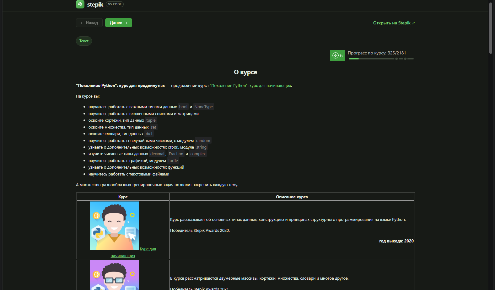
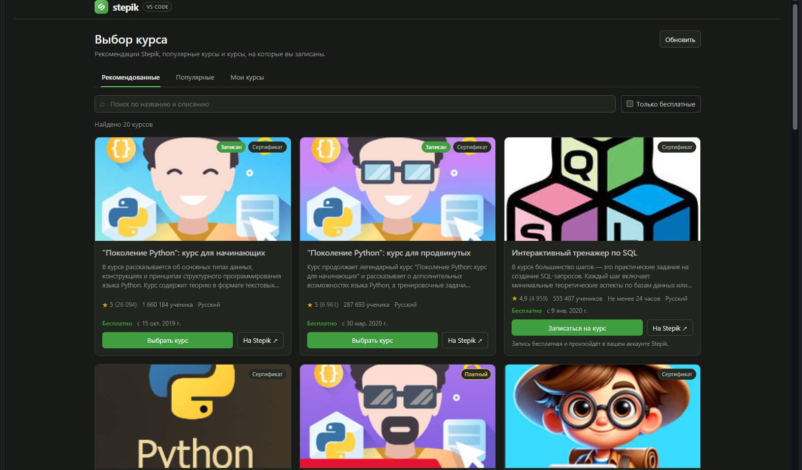
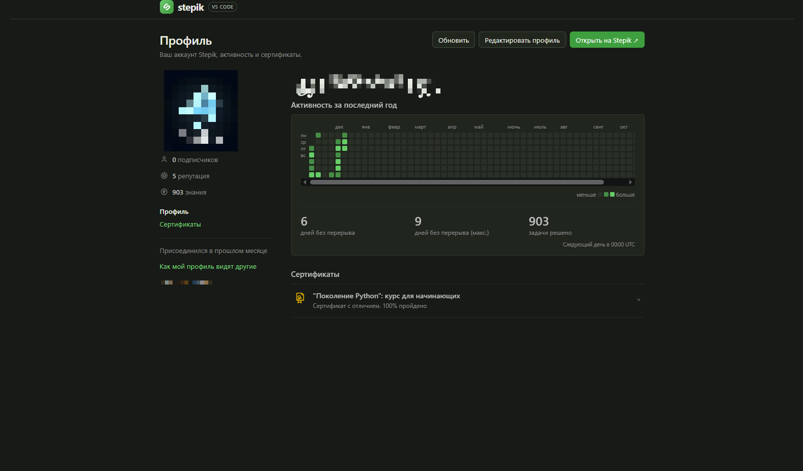
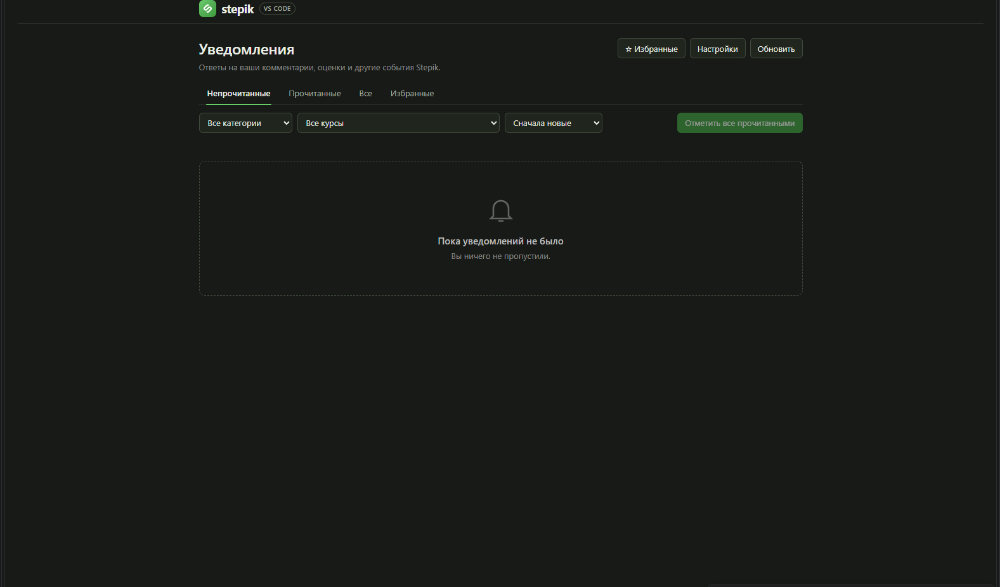
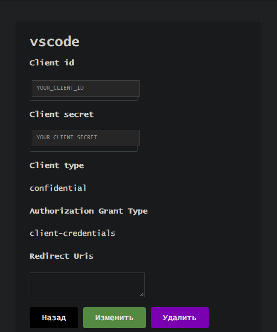
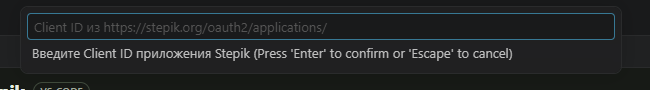
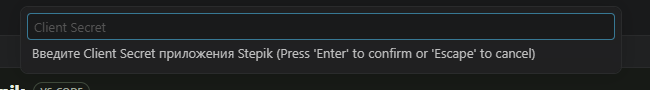

<div align="center">


# Stepik для VS Code

**Решайте задачи Stepik, не покидая редактор.**

Курсы, теория, тесты, код, экзамены, видео и обсуждения — в одном окне VS Code.

[](CHANGELOG.md)
[](https://code.visualstudio.com/)
[](LICENSE.txt)
[](#язык-интерфейса)

[English version](README.en.md) · [Changelog](CHANGELOG.md) · [Issues](https://github.com/danilproskurin291-cmd/stepik-vscode/issues)

</div>



## Что нового в 0.4.12

- **Ответ больше не сбрасывается при переходе между задачами.** Причина была в
  запросе попыток с `user=me`, который Stepik отклоняет: расширение создавало
  новую попытку при каждом открытии шага. Теперь используется реальный id
  пользователя, поэтому сохранённый ответ остаётся на месте.
- **Старые пустые попытки восстанавливают ответ.** Если предыдущая версия уже
  успела создать лишнюю попытку, расширение находит попытку с последним ответом
  и показывает его.
- **«Начать сначала» не отменяется после перезапуска.** Новая попытка остаётся
  пустой и после перезагрузки расширения.
- **Всё из 0.4.11 сохранено:** восстановление ответов, блокировка решённых
  задач, баннеры и исправленные пропуски.

## Возможности

| | |
| --- | --- |
| 📚 **Дерево курса** | Разделы, уроки и шаги с отметками прогресса прямо в боковой панели. |
| 🧩 **Все типы заданий** | Тесты, короткие ответы, числа, формулы, сортировка, таблицы, пропуски, SQL, HTML/CSS, химия, пазлы, код и случайные задачи. |
| 💻 **Решения в файлах** | Отдельная папка `~/stepik/<аккаунт>` со структурой «курс → урок → шаг». |
| ✅ **Проверка и попытки** | Отправка из редактора, подробный результат и новая попытка в один клик. |
| ⏱ **Экзамены** | Таймер, блокировка отправки после дедлайна и восстановление активной сессии. |
| 🎬 **Видео** | Встроенный плеер, качество, субтитры и автоматическая запись просмотра. |
| 💬 **Комментарии** | Rich-редактор, Markdown, формулы, изображения, ответы, оценки и сортировки. |
| 🏆 **Форум решений** | Решения для всех проверяемых типов заданий, включая ответы преподавателя. |
| 📈 **Прогресс** | Серия дней, баллы, шкала выполнения и остаток до сертификата. |
| 🔔 **Уведомления** | Фоновый watcher, тосты и история с непрочитанными. |
| 👤 **Профиль** | Статистика, достижения, сертификаты и публичный предпросмотр. |
| 🌗 **Темы** | Светлая, тёмная и высококонтрастная — без потери читаемости. |
| 🌐 **Язык** | `auto`, `ru` или `en` для всех панелей и уведомлений. |

## Скриншоты

### Каталог курсов

Поиск, рекомендации, популярные курсы, фильтр «только бесплатные» и запись
на бесплатный курс без перехода на сайт.



### Панель задачи

Условие, форма ответа, прогресс, комментарии и форум решений собраны в одной
панели. Для задач с кодом файл решения открывается рядом в редакторе.


### Профиль

Статистика обучения, серия дней, достижения и сертификаты. Аватар, имя и ID
на скриншоте скрыты.



### Уведомления

Ответы на комментарии, проверки решений и другие события Stepik.



## Установка

### Готовый VSIX

1. Скачайте `stepik-vscode-fork-0.4.12.vsix` из
   [Releases](https://github.com/danilproskurin291-cmd/stepik-vscode/releases).
2. Установите файл:

   ```bash
   code --install-extension stepik-vscode-fork-0.4.12.vsix
   ```

   Или откройте **Extensions → … → Install from VSIX…** и выберите файл.
3. Перезагрузите окно: **Developer: Reload Window**.

После установки значок Stepik появится на панели активности.

### Из исходников

Нужен Node.js 18+.

```bash
npm ci
npm run build
npx @vscode/vsce package
code --install-extension stepik-vscode-fork-0.4.12.vsix
```

## Быстрый старт

1. Нажмите значок **Stepik** на панели активности.
2. Выполните **Stepik: Login** и введите OAuth-данные приложения.
3. Выберите курс командой **Stepik: Select Course** или откройте каталог
   **Stepik: Browse Courses**.
4. Откройте любой шаг в дереве.
5. Решайте задачу в панели или в файле редактора и отправляйте ответ.

При первом входе расширение само создаёт папку решений
`~/stepik/<имя-аккаунта>`. Открывать её как рабочую папку не нужно.

## Вход через OAuth

Расширение использует OAuth 2.0 с grant type `client-credentials`. Логин и
пароль от Stepik вводить не нужно — только Client ID и Client Secret вашего
OAuth-приложения.

### 1. Создайте приложение

1. Войдите на Stepik и откройте
   <https://stepik.org/oauth2/applications/>.
2. Нажмите **«Новое приложение»**.
3. Укажите:
   - **Название** — любое, например `Stepik VS Code`;
   - **Client type** — `confidential`;
   - **Authorization grant type** — `client-credentials`;
   - **Redirect uris** — можно оставить пустым.
4. Сохраните приложение и скопируйте **Client ID** и **Client Secret**.



> На скриншоте Client ID и Client Secret заменены заглушками
> `YOUR_CLIENT_ID` и `YOUR_CLIENT_SECRET`. Ваши реальные ключи нигде не
> публикуются.

### 2. Введите Client ID

Выполните **Stepik: Login**. VS Code попросит Client ID:



### 3. Введите Client Secret

Секрет вводится скрыто и сохраняется в защищённом хранилище VS Code
(`SecretStorage`), а не в обычных настройках.



После входа access token обновляется автоматически. Команда
**Stepik: Logout** сначала создаёт ZIP-архив решений, затем удаляет учётные
данные.

## Язык интерфейса

Язык переключается командой **Stepik: Change Interface Language** или через
настройку:

```json
"stepik.language": "auto"
```

| Значение | Поведение |
| --- | --- |
| `auto` | Язык VS Code, а при отсутствии перевода — английский. |
| `ru` | Русский интерфейс. |
| `en` | Английский интерфейс. |

Настройка применяется сразу: панели, дерево, уведомления, профиль и каталог
обновляются без перезапуска.

## Интерфейс

### Боковая панель

Дерево выбранного курса показывает разделы, уроки и шаги. Цвета и значки
подсказывают состояние:

- 🟢 зелёный — шаг или урок пройден;
- 🟡 жёлтый — шаг начат, но ещё не завершён;
- 🔒 замок — материал заблокирован;
- ⏱ экзаменационный раздел предлагает **«Начать экзамен»**.

В заголовке панели доступны выбор курса, обновление, уведомления, профиль,
вход/выход и переключение языка.

### Панель задачи

При открытии шага открывается панель **Stepik Task**:

- кнопки **«← Назад»** и **«Далее →»**;
- ссылка **Open on Stepik ↗**;
- тип задания и условие;
- форма ответа или выбор языка для задач с кодом;
- блок прогресса;
- комментарии и вкладка решений.

### Прогресс

В панели задачи показываются серия дней, набранные и максимальные баллы,
шкала выполнения и подсказка о том, сколько осталось до сертификата.

## Решение задач

### Задачи с кодом

1. Откройте шаг типа **код**.
2. Выберите язык программирования.
3. Нажмите **Open in Editor**.
4. Напишите решение в созданном файле и сохраните его.
5. Отправьте решение кнопкой облака в заголовке редактора или командой
   **Stepik: Submit Solution**.

Путь к файлу:
`~/stepik/<имя-аккаунта>/<курс>/<урок>/step-<номер>.<расширение>`.

Шаблон создаётся один раз и никогда не перезаписывает существующий файл.
Если файл перемещён вручную, откройте шаг заново — расширение восстановит
связь файла с заданием.

### Другие типы заданий

Поддерживаются все проверяемые типы Stepik. Обычно достаточно заполнить форму
и нажать **«Отправить»**. Если ответ неверный, подробности появятся в
уведомлении и в **Output → Stepik**.

| Тип шага | Что делает расширение |
| --- | --- |
| `text` | Показывает теорию и отмечает шаг просмотренным. |
| `video` | Встроенный плеер с качеством, субтитрами и учётом просмотра. |
| `choice` | Один или несколько вариантов ответа. |
| `string`, `number` | Короткий текстовый или числовой ответ. |
| `math` | Формула с проверкой эквивалентности. |
| `free-answer` | Развёрнутый ответ (без файловых вложений). |
| `sorting`, `matching`, `table` | Сортировка, пары и табличная задача. |
| `fill-blanks` | Пропуски: ввод текста или выбор из списка. |
| `sql`, `html` | SQL- и HTML/CSS-задачи с проверкой. |
| `dataset` | Файл с данными и отправка решения. |
| `chemical`, `puzzle` | Химическая формула и пазл. |
| `code` | Файл решения в редакторе, выбор языка и отправка. |
| `random-tasks` | Пояснение и ссылка на шаг Stepik: случайная задача генерируется на стороне Stepik. |

Шаги `text` и `video` открываются как материал и автоматически отмечаются
просмотренными. Для `random-tasks` расширение не создаёт попытку: вместо формы
ответа показывается подсказка и ссылка **«Открыть шаг на Stepik ↗»**.

## Экзамены

1. Нажмите **«Начать экзамен»** у экзаменационного раздела.
2. Подтвердите старт.
3. Расширение создаст сессию через API Stepik и откроет первый шаг.
4. В панели появится таймер **«Осталось …»**.

После окончания времени отправка блокируется. Если экзамен уже начат на
сайте или в другом окне, расширение продолжит существующую сессию.

## Видео

Видео-шаги открываются во встроенном плеере: качество, субтитры, превью,
полноэкранный режим и ссылка на оригинал. Просмотр автоматически
записывается на Stepik.

Встроенный Chromium в VS Code не декодирует AAC-звук из MP4, поэтому при
первом открытии расширение скачивает ролик, извлекает звук, конвертирует его
в MP3 и кэширует. Если звук не включился, нажмите **«Включить звук»** или
откройте видео в браузере.

## Комментарии и форум решений

- первая страница комментариев загружается при открытии шага;
- следующие страницы подгружаются при прокрутке;
- закреплённые комментарии показываются отдельно;
- ответы раскрываются кнопкой **«Показать ответы (N)»**;
- поддерживаются оценки, сортировки и отметки преподавателя;
- свои комментарии можно редактировать, удалять и копировать ссылкой.

Rich-редактор поддерживает **B**, **I**, **U**, зачёркивание, встроенный код,
надстрочный и подстрочный текст, цитаты, списки, блоки кода, формулы,
изображения и ссылки. Кнопка **Markdown** переключает исходный режим,
**Предпросмотр** возвращает живой предпросмотр.

### Форум решений

Вкладка **«Решения»** доступна у всех проверяемых типов заданий. Если форум
закрыт, панель объясняет условие открытия и предлагает **«Проверить снова»**.

В форуме можно сортировать обсуждение, приложить своё отправленное решение,
посмотреть код, выбранные варианты, порядок сортировки, пары, таблицы,
пропуски, SQL/HTML или файл, а также увидеть решения преподавателя.

## Формулы

Формулы рендерятся в условиях, вариантах ответа и комментариях. Поддержаны
`$...$`, `$$...$$`, `\(...\)`, `\[...\]`, дроби, корни, степени, интегралы и
другие команды KaTeX.

Используется MathML-вывод KaTeX: внешние шрифты не нужны, CSP не ослабляется.
Кириллица внутри формул автоматически оборачивается в `\text{...}`.

## Команды

Палитра команд: `Ctrl+Shift+P` (Windows/Linux) или `Cmd+Shift+P` (macOS).

| Команда | Действие |
| --- | --- |
| **Stepik: Login** | Вход по Client ID и Client Secret |
| **Stepik: Logout** | Архив решений, выход и удаление учётных данных |
| **Stepik: Archive Account Solutions** | ZIP-архив решений текущего аккаунта |
| **Stepik: Refresh** | Обновление дерева и прогресса |
| **Stepik: Select Course** | Выбор курса из списка |
| **Stepik: Browse Courses** | Каталог, рекомендации и поиск |
| **Stepik: Show Notifications** | Уведомления Stepik |
| **Stepik: Show Profile** | Профиль и статистика |
| **Stepik: Change Interface Language** | Русский / английский интерфейс |
| **Stepik: Submit Solution** | Отправка текущего файла решения |

Горячие клавиши в редакторе комментария:

| Клавиши | Действие |
| --- | --- |
| `Ctrl+B` | Жирный |
| `Ctrl+I` | Курсив |
| `Ctrl+E` | Встроенный код |
| `Ctrl+K` | Ссылка |
| `Ctrl+Enter` | Отправить комментарий или решение |

На macOS используйте `Cmd` вместо `Ctrl`.

## Папка решений

Решения хранятся в `~/stepik/<имя-аккаунта>` независимо от папки, открытой
в VS Code:

```text
~/stepik/
├── DanilProskurin/
│   ├── Курс 1/
│   │   ├── Урок 1/
│   │   │   ├── step-1.py
│   │   │   └── step-2.py
│   │   └── Урок 2/
│   │       └── step-1.cpp
│   └── .stepik/
│       ├── account.json
│       └── mapping.json
└── archive/
    └── 1405465614.zip
```

`.stepik/mapping.json` связывает абсолютный путь файла с заданием Stepik,
`.stepik/account.json` хранит ID и имя аккаунта. Не перемещайте файлы вручную
без повторного открытия шага.

## Аккаунты и архив

- Аккаунт определяется парой «неизменяемый ID Stepik + имя», поэтому два
  аккаунта с одинаковым именем получают разные папки: `<имя>` и
  `<имя> (<ID>)`.
- Перед выходом или сменой аккаунта создаётся ZIP-архив
  `~/stepik/archive/<ID>.zip` со всеми решениями и служебной папкой `.stepik`.
- Архив можно создать вручную командой
  **Stepik: Archive Account Solutions**.
- Если архивация не удалась, выход отменяется — данные не теряются.
- Старая папка `~/.stepik` из версий до 0.4.2 автоматически переносится в
  папку первого аккаунта и сохраняется как `~/.stepik.backup-<время>`.

## Решение проблем

### Не удаётся войти

- Проверьте, что у приложения тип `confidential` и grant type
  `client-credentials`.
- Скопируйте Client ID и Client Secret заново, без лишних пробелов.
- Убедитесь, что используете данные нужного приложения.
- Откройте **Output → Stepik** и посмотрите текст ошибки.

### Нет курсов в списке

- Проверьте, что вы записаны на курс на stepik.org.
- Выполните **Stepik: Refresh**.
- Выйдите и войдите снова, если аккаунт сменился.

### Шаг не открывается

- Раздел может быть заблокирован до прохождения предыдущих уроков.
- Для экзамена нажмите **«Начать экзамен»** и проверьте, не истекло ли время.

### Отправка решения не работает

- Убедитесь, что папка `~/stepik/<имя-аккаунта>` доступна для записи.
- Откройте шаг заново, чтобы обновить связь файла с заданием.
- Не перемещайте файл после создания.
- Для экзамена проверьте, что сессия активна.

### Нет звука в видео

- Дождитесь завершения скачивания и конвертации — прогресс виден под плеером.
- Нажмите **«Включить звук»**, если автовоспроизведение заблокировано.
- Откройте видео в браузере — там звук и полный экран работают нативно.

## Требования

- VS Code 1.85 или новее;
- аккаунт на [stepik.org](https://stepik.org);
- собственное OAuth-приложение Stepik;
- Node.js 18+ — только для сборки из исходников.

Расширение не является официальным клиентом Stepik. Оно работает через
публичный API Stepik и использует ваши OAuth-данные.

## Сборка из исходников

```bash
npm ci
npm run build
npx tsc --noEmit
npx @vscode/vsce package
```

Готовая сборка: `dist/extension.js` и `dist/audioWorker.js`.
Установочный пакет: `stepik-vscode-fork-0.4.12.vsix`.

## Ограничения

- нужен аккаунт Stepik и собственное OAuth-приложение;
- отправка комментариев, голосование и форум решений зависят от прав аккаунта
  и ограничений Stepik;
- файловые ответы и вложения в `free-answer` не поддерживаются;
- API Stepik может меняться без предупреждения;
- встроенный плеер зависит от кодека и возможностей Chromium в VS Code.

## Автор

**Данил Проскурин**  
Псевдоним: **꧁༒☬𝔉𝔜𝔡𝔡𝔡𝔡𝔰𝔰☬༒꧂**

- Репозиторий: <https://github.com/danilproskurin291-cmd/stepik-vscode>
- Оригинальный проект: <https://github.com/su-mt/stepik-vscode>

## Лицензия

GNU General Public License v3.0. См. [LICENSE.txt](LICENSE.txt).
